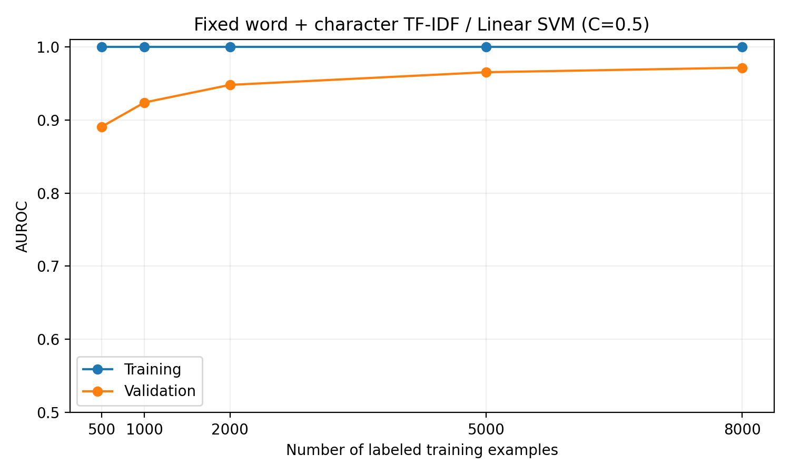

> Historical Q2 and supervised-baseline Q4 analysis. The final selected model is now NB-weighted; use `report/main.tex` and `final_results/` for the final-model Q4 results. The Q2 experiment below remains valid.

# Person C — Q2 and Q4

Completed using the committed training and validation IDs and the selected supervised word + character TF-IDF / Linear SVM (C=0.5). All numbers below come from `person_c_results/`. This analysis does not replace Person B's semi-supervised or robustness experiments.

## Q2. Effect of training data size

### Method

We kept the team's fixed 8,000/2,000 training/validation partition. Within the training partition, we independently shuffled each class with seed 42 and interleaved the class pools to obtain balanced, nested subsets of 500, 1,000, 2,000, 5,000, and 8,000 examples. The full-size fit retained the committed training row order. Every validation evaluation used exactly the same 2,000 examples; none entered feature fitting or model training.

The configuration remained fixed: word TF-IDF (1–2 grams, maximum 100,000 features), character TF-IDF (3–5 grams, maximum 150,000 features), min_df=2 and sublinear term frequency for both, followed by LinearSVC(C=0.5, random_state=42). Each subset independently fitted its vocabulary and IDF weights. Training AUROC was measured on that subset and validation AUROC on the fixed holdout, using SVM decision scores. Vocabulary contents can change with sample size even though hyperparameters remain fixed.

### Results

| Labeled training examples | Training AUROC | Validation AUROC | Train–validation gap | Fit time (s) |
| ---: | ---: | ---: | ---: | ---: |
| 500 | 1.000000 | 0.890672 | 0.109328 | 0.63 |
| 1,000 | 1.000000 | 0.923734 | 0.076266 | 1.28 |
| 2,000 | 1.000000 | 0.947738 | 0.052262 | 2.62 |
| 5,000 | 1.000000 | 0.965055 | 0.034945 | 6.26 |
| 8,000 | 1.000000 | 0.971228 | 0.028772 | 9.77 |



Fit time includes TF-IDF fitting/transformation and SVM fitting, but excludes evaluation and probability calibration. Times are specific to the local execution environment and should not be compared directly with scripts that time only the SVM fit.

### Interpretation

The model perfectly ranks the training examples at every size, while held-out performance is lower. The large gap at 500 examples is consistent with overfitting in a high-dimensional representation, rather than an inability to fit the training data. As the sample size grows, validation AUROC increases monotonically and the gap narrows from 0.109328 to 0.028772.

Increasing the training set from 500 to 8,000 examples improves validation AUROC by 0.080556. There are diminishing returns: adding 3,000 examples from 2,000 to 5,000 improves AUROC by 0.017317, whereas adding another 3,000 from 5,000 to 8,000 improves it by 0.006173. More labeled data from a similar distribution therefore appears useful, although the curve does not establish the gain beyond 8,000 examples. One seeded set of nested subsets does not quantify sampling uncertainty; a plateau or statistically reliable difference cannot be established from this curve alone. More data from the same distribution also need not resolve a distribution shift at test time.

## Q4. Generalization and error analysis

### Overall generalization

The selected supervised model fitted on all 8,000 training examples achieved training AUROC **1.000000** and validation AUROC **0.971228**, a gap of **0.028772**. Strong held-out ranking performance coexists with some overfitting. AUROC measures ranking and does not by itself describe errors at a chosen classification threshold.

Using the original SVM decision rule (margin > 0 predicts AI), the validation confusion matrix is:

| True class | Predicted human | Predicted AI |
| --- | ---: | ---: |
| Human | 950 | 50 |
| AI | 127 | 873 |

Thus, 50 human passages were flagged as AI (5.0% false-positive rate), and 127 AI passages were missed (12.7% false-negative rate). Accuracy at this operating point is 91.15%. Threshold selection would trade off these error types without changing AUROC; no threshold was tuned on the validation set here.

**Reproduction note.** The team's earlier committed value is 0.971122. Running the original, unchanged `run_word_char_improvement.py` in the current environment gives **0.971228** at C=0.5, exactly matching the new evaluation script. The original script's split IDs and order were also checked against the committed files and match exactly. The historical difference is 0.000106; its precise cause is unconfirmed because the earlier environment was not pinned. We retain the actual current result rather than substituting the historical number. The original-script rerun is saved as `original_script_reproduction.csv`.

### Performance by text length

Length is the number of whitespace-separated words. Training-set tertiles were 175 and 240 words, defining short (≤175), medium (176–240), and long (>240) passages. Boundaries were determined without using validation labels; equal lengths were kept together.

| Group | Observed validation word range | Count | Human / AI | Validation AUROC | FP | FN |
| --- | --- | ---: | --- | ---: | ---: | ---: |
| Short | 76–175 | 711 | 352 / 359 | 0.958732 | 26 | 48 |
| Medium | 176–240 | 643 | 355 / 288 | 0.973797 | 19 | 30 |
| Long | 241–350 | 646 | 293 / 353 | 0.983390 | 5 | 49 |

Ranking performance improves with length: long-passage AUROC exceeds short-passage AUROC by about 0.024658. A plausible explanation is that longer passages provide more lexical and stylistic evidence. This is an association, not a causal result; topic, genre, and class composition may also differ across groups. In particular, the long group still has 49 false negatives at the fixed threshold. Its high AUROC does not imply uniformly lower error rates at that operating point.

### Probability estimates and case selection

Human is label 0 and AI is label 1. We report estimated P(AI) using a logistic sigmoid fitted to three-fold out-of-fold margins from the 8,000 training examples. Each fold independently refits both TF-IDF and SVM. No validation examples or labels are used to fit the sigmoid. The sigmoid is then applied to the full-training model's validation scores.

The fitted transformation is sigmoid(5.952912 × margin + 0.428349). We retain the original SVM classification threshold of margin 0, which corresponds to P(AI) ≈ **0.605479**, rather than changing the classifier to a calibrated-probability threshold of 0.5. The positive sigmoid slope preserves ranking. Estimated probabilities are not guaranteed to be calibrated, especially because the calibration folds use less training data than the final model.

We inspected the five highest-margin false positives and the five lowest-margin false negatives. These are deliberately confident failures, not a representative random sample. The following explanations are qualitative hypotheses based on reading the passages, not proven feature attributions or evidence that the supplied labels are wrong. Full competition texts remain local; IDs allow authorized reproduction.

| ID | Error | Estimated P(AI) | Observed features and possible failure reason |
| ---: | --- | ---: | --- |
| 5234 | FP | 0.994614 | Human keyboard-troubleshooting post. Repeated LED terminology and an orderly problem narrative may resemble generated technical advice despite informal punctuation and a typo. |
| 3671 | FP | 0.971966 | Human biography with third-person facts, institutional names, and polished exposition. This style overlaps with generated biographies. |
| 7562 | FP | 0.957326 | Human recipe with repeated ingredient lists, brand names, and promotional prose. Formulaic repetition may resemble generated recipe text. |
| 2002 | FP | 0.954573 | Human history question with repeated references to rulers and thrones. An organized sequence of questions may resemble generated forum content despite colloquial phrasing. |
| 3743 | FP | 0.950607 | Human first-person request for fiction-writing advice. Repeated vocabulary about characters and world-building may overlap with generated writing advice. |
| 1524 | FN | 0.000917 | AI text mixes a technical quantum-optics abstract with a personal question referring to missing visual context. It resembles a copied technical forum discussion. |
| 3062 | FN | 0.001649 | AI forum-style narrative uses a greeting, personal details, uncertainty, repetition, and awkward phrasing. Informality can imitate human writing. |
| 473 | FN | 0.014525 | AI text imitates a quoted question and attributed answer, with institution names and a link-style ending. Source-like presentation can mimic human web text. |
| 4600 | FN | 0.016158 | AI sports biography lists names, dates, rankings, family details, and an apparent citation-number artifact. Reference-style formatting resembles scraped human text. |
| 9490 | FN | 0.018230 | AI recipe has familiar ingredient/instruction formatting but calls itself meatloaf without listing meat and shifts inconsistently between bread and patties. Local n-grams miss procedural coherence. |

The machine-readable `error_analysis.csv` includes the original margins, lengths, labels, probabilities, observed patterns, and more detailed case-specific reasons. `person_c_error_notes.json` stores the reviewed annotations so the script can reproduce the table. A changed environment may select different errors; unreviewed IDs are explicitly marked for review.

### Recurring patterns and a targeted response

Three themes recur in this selected sample:

1. **Genre can resemble authorship.** Biographies and recipes occur among both false positives and false negatives (3671/4600 and 7562/9490). The model may rely on genre-associated surface cues that do not distinguish authorship reliably.
2. **Conversational language is ambiguous.** Human question posts are falsely flagged (5234, 2002, 3743), while AI can imitate personal forum narratives (1524, 3062, 473). First-person voice, informal grammar, and questions alone are insufficient signals.
3. **Local fluency can hide global inconsistency.** The recipe in 9490 contains recognizable recipe phrases but inconsistent ingredients and steps. Word and character TF-IDF do not explicitly represent long-range procedural relationships.

A targeted next experiment would address genre confounding: manually annotate genre for a training-only sample, ensure both labels are represented within each genre, and compare class-and-genre-balanced training or weighting against the unchanged baseline. Keep the same validation IDs, decide the procedure using training data, and report both overall and genre-specific validation AUROC. This could reduce reliance on topic or format shortcuts, but improvement is not established by the present analysis. The ten inspected cases support a hypothesis, not an estimate of how common each failure pattern is.

The team-reported Kaggle public AUROC of 0.87240 is below the internal validation AUROC. That difference may motivate checking distribution shift, but these scores describe different evaluation populations. We did not inspect hidden test labels or establish the cause of that gap. Repeated model selection on the same fixed validation set can also make its reported performance optimistic; this is not an untouched final test set.

## Reproducibility and AI-use disclosure

From `submissions/group-number-11/`, run:

```bash
python -m pip install -r requirements-person-c.txt
python run_person_c_evaluation.py \
  --train_csv ../../cornell-tech-cs-5785-combined-2026-ai-vs-human-text/train.csv \
  --review_text data/person_c_error_review.csv
```

The reviewed run used Python 3.14.2, NumPy 2.4.2, pandas 3.0.1, SciPy 1.17.0, scikit-learn 1.8.0, and Matplotlib 3.10.8. Exact dependency versions are recorded in `requirements-person-c.txt`. Dataset/split SHA-256 hashes, calibration parameters, and group boundaries are recorded in `evaluation_summary.json`; subset IDs are in `learning_curve_subset_ids.csv`. The local review CSV contains competition text and must not be committed. The report is a reviewed narrative: after rerunning with different data or software, verify its numbers and interpretations against the outputs.

OpenAI Codex assisted with implementation, running the experiments, reading the selected validation examples, drafting the possible failure reasons and report, and checking outputs. Automated checks confirmed fixed split membership, balanced nested subsets, absence of validation IDs from training subsets, metric consistency, and the ten FP/FN classifications. The learning-curve image was visually inspected, and the original model script was independently rerun. Grace should review the qualitative interpretations and disclosure before incorporating them into the team's final report; no human review is claimed here.
